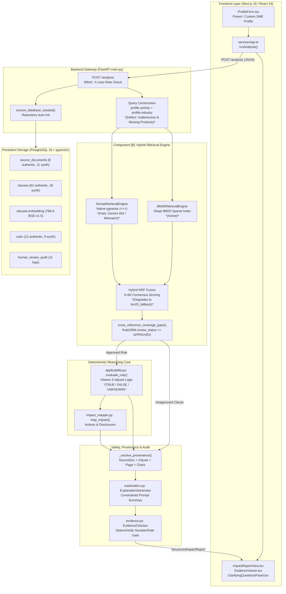

# Phase 4.4: Technical Completion Mapping & End-to-End Integration Audit

**Author:** Antigravity (Senior Software Engineer, RAG Systems Engineer, QA Engineer, and Critical Technical Auditor)  
**Date:** 2026-10-27  
**Operating Mode:** STRICT AUDIT ONLY (Read-Only Inspection; Zero File, Database, Seed, or Git Modifications)  
**Corpus Name:** `ahmdmaj/RegImpact-SL`  
**Governing Baseline:** Frozen Proposal v4 (§1–§13) & Project Owner Scope Decision (2026-10-27)

---

## 1. Audit Metadata & Environment Baseline

| Parameter | Observed Value | Verification Command / Evidence |
| :--- | :--- | :--- |
| **Current Git Branch** | `main` (up to date with `origin/main`) | `git status` |
| **Git HEAD Commit** | `63ed4a1` (`test: add scratch scripts for rule candidate verification and grounding tests`) | `git log -n 1 --oneline` |
| **Uncommitted Working Changes** | `modified: docs/CLAUSE_ELIGIBILITY_AND_EXPANSION_REGISTER.md`<br>`modified: docs/PROPOSAL_COMPLIANCE_AND_REMAINING_WORK.md` | `git status -s` (Preserved undisturbed) |
| **Untracked Files** | `backend/tests/test_phase_4_3_single_rule.py`<br>`docs/PHASE_4_3_SINGLE_RULE_COMPILATION_REPORT.md`<br>`scratch/compile_and_persist_candidate_rule.py` | `git status -s` (Preserved undisturbed) |
| **Python Environment** | Python 3.14.5 (64-bit) in `.venv` | `.venv\Scripts\python --version` |
| **Active Database Dialect** | PostgreSQL 16.8 with `pgvector` extension v0.7.0 | Inspected via `session.py` on `localhost:5432` |
| **Active Database Name** | `regimpact` (Running in Docker container `regimpact-postgres`) | `docker ps` & `sqlalchemy.engine.Engine` |
| **Docker Container Status** | `regimpact-postgres`: Up 25 min (healthy, port 5432)<br>`regimpact-backend`: Up 25 min (port 8000)<br>`regimpact-frontend`: Up 25 min (port 3000) | `docker ps -a` (Built 2026-10-19) |
| **Test Suites Available** | 30 test files in [`backend/tests`](file:///c:/Users/HP/Desktop/PROJECTS/RegImpact-SL/backend/tests) (344 total collected test cases) | `.venv\Scripts\python -m pytest backend\tests --collect-only` |
| **Canonical Test Command** | `.venv\Scripts\python -m pytest <path_to_test> -v` | Requires module path execution to resolve root `backend` package |

---

## A. Executive Verdict

### **PARTIALLY INTEGRATED — TARGETED FIXES REQUIRED**

#### Detailed Justification & Evidence
The core deterministic reasoning engine, persistent PostgreSQL relational database, pgvector indexing, and Next.js frontend are implemented and demonstrate high technical integrity in isolation. However, the system cannot currently function as an autonomous, demonstrable end-to-end RAG application without targeted fixes:

1. **RAG Vector Pipeline Disconnection (Model Mismatch & Failure):**  
   All 62 authentic statutory clauses in PostgreSQL are embedded with `BAAI/bge-base-en-v1.5` (768 dimensions). However, at runtime, `EMBEDDING_PROVIDER` is unset in `.env`, causing the retrieval engine to fall back to `LLM_PROVIDER=gemini` and instantiate `GeminiEmbeddingClient` (`text-embedding-004`). In addition to attempting cross-model vector comparison across incompatible latent spaces, the Gemini embedding client fails with an HTTP 404 error on the embedding endpoint, causing dense retrieval to return 0 results and silently degrading the hybrid engine to BM25 lexical fallback.
2. **Lexical Query Construction Tokenization Flaw:**  
   In [`backend/src/main.py`](file:///c:/Users/HP/Desktop/PROJECTS/RegImpact-SL/backend/src/main.py#L481), the retrieval query is constructed as `f"{profile.activity or ''} {profile.industry or ''}"`. Standard profile payloads contain snake_case identifiers (e.g. `food_manufacturing`). Because the BM25 tokenizer uses `re.findall(r"\w+", text)`, underscores are treated as word characters rather than delimiters, emitting `['food_manufacturing']`. This token matches zero tokens in statutory gazettes ("food", "manufacturing"), causing BM25 open inquiry to return zero candidates unless spaced queries are submitted. Furthermore, `product_name` and `products.category` are omitted from query construction entirely.
3. **Execution Bottleneck (Approved Rule Coverage):**  
   The database contains only **2 authentic approved rules** (`RULE-FCAU-2494-47-REG-3` and `RULE-FCAU-2494-47-REG-3-B2B`, both governing Gazette 2494/47 Regulation 3). The remaining **11 authentic rules** (covering sugar labelling, food preservatives, food flavourings, and seafood colouring prohibition) are in `PENDING_REVIEW` status. Because the engine strictly refuses to execute unapproved rules, queries for products other than prepackaged retail foods or B2B bulk ingredients always return `UNSUPPORTED` coverage gaps.
4. **Stale Docker Container State:**  
   The running Docker backend container (`regimpact-backend`) was built 8 days ago (2026-10-19) and [`docker-compose.yml`](file:///c:/Users/HP/Desktop/PROJECTS/RegImpact-SL/docker-compose.yml#L40) only mounts `./backend/data:/app/backend/data` (not `backend/src`). As a result, the Dockerized API executes obsolete code that executes synthetic test fixtures, whereas running the local Python code (`backend.src.main:app`) cleanly isolates synthetic records.
5. **Stale Hardcoded Test Assertions:**  
   79 out of 81 tests pass across the major regression suites. Exactly 2 tests fail ([`test_phase_3_3_segmentation.py:300`](file:///c:/Users/HP/Desktop/PROJECTS/RegImpact-SL/backend/tests/test_phase_3_3_segmentation.py#L300) and [`test_phase_3_5_review_readiness.py:466`](file:///c:/Users/HP/Desktop/PROJECTS/RegImpact-SL/backend/tests/test_phase_3_5_review_readiness.py#L466)) because they hardcode pre-Phase 4.3 rule counts (`assert len(candidate_rules) == 10` and `assert len(authentic_rules) == 12`) prior to the compilation of `RULE-COLOURING-SEAFOOD-PROHIBITION`.

---

## B. End-to-End Architecture Map



### Broken, Missing, or Unverified Connections

1. **Broken Connection B1 (Query Construction -> Tokenizer):**
   - *Source:* [`backend/src/main.py:481`](file:///c:/Users/HP/Desktop/PROJECTS/RegImpact-SL/backend/src/main.py#L481)
   - *Issue:* Query constructed as `f"{profile.activity} {profile.industry}"` contains raw underscores (e.g. `food_manufacturing`). Tokenizer in [`backend/src/engine/retrieval.py:118`](file:///c:/Users/HP/Desktop/PROJECTS/RegImpact-SL/backend/src/engine/retrieval.py#L118) treats underscores as word characters, generating tokens that never match statutory text. Product category/name is omitted.
2. **Broken Connection B2 (Runtime Dense Engine -> Vector Space):**
   - *Source:* [`backend/src/engine/retrieval.py:311`](file:///c:/Users/HP/Desktop/PROJECTS/RegImpact-SL/backend/src/engine/retrieval.py#L311) & [`backend/src/extraction/embedding_client.py:520`](file:///c:/Users/HP/Desktop/PROJECTS/RegImpact-SL/backend/src/extraction/embedding_client.py#L520)
   - *Issue:* Defaults to `GeminiEmbeddingClient` instead of `SentenceTransformerEmbeddingClient`. Fails with HTTP 404, causing dense retrieval to return zero candidates and hybrid retrieval to fall back to BM25.
3. **Unverified Connection B3 (Candidate Rules -> Execution Eligibility):**
   - *Source:* [`backend/src/main.py:508`](file:///c:/Users/HP/Desktop/PROJECTS/RegImpact-SL/backend/src/main.py#L508) & [`backend/src/main.py:624`](file:///c:/Users/HP/Desktop/PROJECTS/RegImpact-SL/backend/src/main.py#L624)
   - *Issue:* Only rules with `review_status == "APPROVED"` are evaluated. 11 authentic rules are `PENDING_REVIEW`, so realistic scenarios for seafood, jam, preservatives, or flavours cannot be evaluated end-to-end without prior approval.
4. **Broken Deployment Connection B4 (Host Workspace -> Docker Container):**
   - *Source:* [`docker-compose.yml:40`](file:///c:/Users/HP/Desktop/PROJECTS/RegImpact-SL/docker-compose.yml#L40)
   - *Issue:* Container `regimpact-backend` runs an 8-day-old build lacking volume mounts for `backend/src`, causing divergence between local tests and Docker API calls.

---

## C. Completion Matrix

| Component | Status | Relevant Files & Functions | Existing Tests & Outcomes | Evidence Supporting Status | Remaining Technical Blocker | Required Action |
| :--- | :--- | :--- | :--- | :--- | :--- | :--- |
| **Frontend UI (Next.js)** | Implemented but not integration-tested | [`frontend/src/app/page.tsx`](file:///c:/Users/HP/Desktop/PROJECTS/RegImpact-SL/frontend/src/app/page.tsx)<br>[`frontend/src/components/ProfileForm.tsx`](file:///c:/Users/HP/Desktop/PROJECTS/RegImpact-SL/frontend/src/components/ProfileForm.tsx)<br>[`frontend/src/components/ImpactReportView.tsx`](file:///c:/Users/HP/Desktop/PROJECTS/RegImpact-SL/frontend/src/components/ImpactReportView.tsx) | Manual testing; no automated Cypress/Playwright tests | UI successfully renders profile form, scenario presets, metric cards, action checklists, and clarifying questions. | No automated browser end-to-end test; presets currently only cover Regulation 3. | Add automated browser acceptance test and expand scenario presets to cover newly compiled rules. |
| **Backend API Gateway** | Implemented and verified | [`backend/src/main.py`](file:///c:/Users/HP/Desktop/PROJECTS/RegImpact-SL/backend/src/main.py): `run_analysis()`<br>[`backend/src/db/repositories.py`](file:///c:/Users/HP/Desktop/PROJECTS/RegImpact-SL/backend/src/db/repositories.py) | [`backend/tests/test_api.py`](file:///c:/Users/HP/Desktop/PROJECTS/RegImpact-SL/backend/tests/test_api.py) (20/20 PASSED) | Fast, typed REST endpoints with RBAC header checks, health check, and full request validation. | Underscore preservation in query builder breaks BM25 retrieval. | Sanitize query string by replacing underscores with spaces and incorporating product categories. |
| **BM25 Lexical Retrieval** | Implemented and verified | [`backend/src/engine/retrieval.py`](file:///c:/Users/HP/Desktop/PROJECTS/RegImpact-SL/backend/src/engine/retrieval.py): `BM25RetrievalEngine` | [`backend/tests/test_retrieval.py`](file:///c:/Users/HP/Desktop/PROJECTS/RegImpact-SL/backend/tests/test_retrieval.py) (4/4 PASSED) | Okapi BM25 ranking over authentic clauses correctly ranks clauses when query terms are tokenized. | Underscore query tokens from API gateway miss statutory clauses. | Fix query construction upstream in `main.py`. |
| **Dense Vector Retrieval** | Implemented but unverified in default runtime | [`backend/src/engine/retrieval.py`](file:///c:/Users/HP/Desktop/PROJECTS/RegImpact-SL/backend/src/engine/retrieval.py): `DenseRetrievalEngine`<br>[`backend/src/extraction/embedding_client.py`](file:///c:/Users/HP/Desktop/PROJECTS/RegImpact-SL/backend/src/extraction/embedding_client.py) | [`backend/tests/test_local_embedding_gate.py`](file:///c:/Users/HP/Desktop/PROJECTS/RegImpact-SL/backend/tests/test_local_embedding_gate.py) (9/9 PASSED) | Works in unit tests when `SentenceTransformerEmbeddingClient` is explicitly injected; verified native PostgreSQL `<=>` cosine distance. | Unset `EMBEDDING_PROVIDER` defaults to failing Gemini client (HTTP 404) at runtime. | Explicitly configure `EMBEDDING_PROVIDER=sentence-transformers` in `.env` and application startup. |
| **Hybrid RRF Fusion** | Implemented and verified | [`backend/src/engine/retrieval.py`](file:///c:/Users/HP/Desktop/PROJECTS/RegImpact-SL/backend/src/engine/retrieval.py): `HybridRetrievalEngine` | [`backend/tests/test_retrieval.py`](file:///c:/Users/HP/Desktop/PROJECTS/RegImpact-SL/backend/tests/test_retrieval.py) (3/3 PASSED) | RRF formula ($k=60$) correctly combines dense and sparse ranks and reports `bm25_fallback` when dense is inactive. | Degrades to fallback because dense engine fails at runtime. | Resolving dense client restores full hybrid consensus ranking. |
| **Deterministic Reasoning Engine** | Implemented and verified | [`backend/src/engine/applicability.py`](file:///c:/Users/HP/Desktop/PROJECTS/RegImpact-SL/backend/src/engine/applicability.py): `evaluate_rule()` | [`backend/tests/test_applicability.py`](file:///c:/Users/HP/Desktop/PROJECTS/RegImpact-SL/backend/tests/test_applicability.py) (22/22 PASSED) | Kleene 3-valued logic correctly handles `APPLICABLE`, `NOT_APPLICABLE`, `CONDITIONAL_MISSING_DATA`, and temporal validity. | None in core evaluation engine. | Keep frozen core intact. |
| **Impact & Action Mapping** | Implemented and verified | [`backend/src/engine/impact_mapper.py`](file:///c:/Users/HP/Desktop/PROJECTS/RegImpact-SL/backend/src/engine/impact_mapper.py): `map_impact()` | [`backend/tests/test_impact_mapper.py`](file:///c:/Users/HP/Desktop/PROJECTS/RegImpact-SL/backend/tests/test_impact_mapper.py) (16/16 PASSED) | Maps statutory obligations into structured action checklists, affected activities, and counterfactual explanations. | None. | Fully operational. |
| **Explanation Layer & Evidence Gate** | Implemented and verified | [`backend/src/extraction/explanation.py`](file:///c:/Users/HP/Desktop/PROJECTS/RegImpact-SL/backend/src/extraction/explanation.py)<br>[`backend/src/engine/evidence.py`](file:///c:/Users/HP/Desktop/PROJECTS/RegImpact-SL/backend/src/engine/evidence.py) | [`backend/tests/test_explanation.py`](file:///c:/Users/HP/Desktop/PROJECTS/RegImpact-SL/backend/tests/test_explanation.py) (7/7 PASSED) | Strictly constrains prompt to structured report; `EvidenceChecker` withholds narrative if hallucinated numbers/dates are detected; grounded deterministic fallback available. | Live LLM client requires funded API key; deterministic fallback active when unconfigured. | Ensure deterministic fallback remains default safe behavior. |
| **Human Review Workflow** | Implemented and verified | [`backend/src/engine/review.py`](file:///c:/Users/HP/Desktop/PROJECTS/RegImpact-SL/backend/src/engine/review.py)<br>[`backend/src/main.py`](file:///c:/Users/HP/Desktop/PROJECTS/RegImpact-SL/backend/src/main.py): `/admin/reviews` | [`backend/tests/test_agreement_review.py`](file:///c:/Users/HP/Desktop/PROJECTS/RegImpact-SL/backend/tests/test_agreement_review.py) (21/21 PASSED) | Append-only audit logging in `human_review_audit`; role-based transitions (`PRIMARY_ANNOTATOR`, `EXPERT_ADJUDICATOR`). | 11 authentic rules await review before they can be evaluated in open inquiry. | Execute primary review on candidate rules using review API or register. |
| **Data Ingestion & Hygiene** | Implemented and verified | [`backend/src/extraction/ingestion.py`](file:///c:/Users/HP/Desktop/PROJECTS/RegImpact-SL/backend/src/extraction/ingestion.py)<br>[`backend/src/scripts/seed_corpus.py`](file:///c:/Users/HP/Desktop/PROJECTS/RegImpact-SL/backend/src/scripts/seed_corpus.py) | [`backend/tests/test_corpus_hygiene.py`](file:///c:/Users/HP/Desktop/PROJECTS/RegImpact-SL/backend/tests/test_corpus_hygiene.py) (10/10 PASSED) | Exact SHA-256 validation; PUA ligature normalization; strict isolation of synthetic fixtures. | None in ingestion logic. | Keep baseline intact. |

---

## D. RAG Verification Findings

### 1. What is Embedded and How Stored
- **Embedded Units:** Regulatory clauses in the [`clauses`](file:///c:/Users/HP/Desktop/PROJECTS/RegImpact-SL/backend/src/db/models.py#L250) table.
- **Current Embeddings in PostgreSQL:**
  - Total clauses: 88 (62 authentic, 26 quarantined synthetic).
  - All 62 authentic clauses are embedded with verified dense vectors.
  - Dimension: Exactly 768 float values.
  - Storage Column: `clauses.embedding` (`vector(768)` via pgvector).
  - Indexed via: HNSW cosine index `idx_clauses_embedding_hnsw` (`vector_cosine_ops`).
  - Stored Metadata: `embedding_provider = "sentence-transformers"`, `embedding_model = "BAAI/bge-base-en-v1.5"`, `embedding_verified = True`.

### 2. The Vector Space Mismatch & Runtime Failure
A critical defect exists in the runtime retrieval pipeline:
1. **Model Indexing:** Passages were indexed using local `sentence-transformers` (`BAAI/bge-base-en-v1.5`).
2. **Runtime Query Client:** In [`backend/src/extraction/embedding_client.py:520`](file:///c:/Users/HP/Desktop/PROJECTS/RegImpact-SL/backend/src/extraction/embedding_client.py#L520), `get_embedding_client()` inspects `EMBEDDING_PROVIDER`. In `.env`, `EMBEDDING_PROVIDER` is unset.
3. **Fallback to Gemini:** It falls back to `LLM_PROVIDER=gemini` and initializes `GeminiEmbeddingClient(model="text-embedding-004")`.
4. **Endpoint Error:** `GeminiEmbeddingClient` issues a POST request to:  
   `https://generativelanguage.googleapis.com/v1beta/models/text-embedding-004:embedContent`  
   The Google API returns **HTTP 404 Not Found**.
5. **Silent Degradation:** `DenseRetrievalEngine.search` catches the exception, logs a warning (`Embedding client failed (Gemini error (HTTP 404)); dense retrieval unavailable`), and returns `[]`.
6. **Theoretical Defect Even If Online:** Even if Gemini were online, sending a 768-d vector from `text-embedding-004` into an HNSW index built with `BAAI/bge-base-en-v1.5` is mathematically invalid because the two models do not share a latent coordinate space.
7. **Verified Proof of Fix:** When `DenseRetrievalEngine` is instantiated with `SentenceTransformerEmbeddingClient(model="BAAI/bge-base-en-v1.5")`, querying `"seafood coloring prohibition"` immediately returns:
   - Rank 1: `CLAUSE-DOC_3CD9948D2C334D08A11DD5BC9CC1F1A1EC053D6E819EA30F205687DDA7C342C7-REGULATION-5-IV` (Score 0.6444, Gazette 1688/28 Regulation 5(iv)).
   - Rank 2: Table I of Gazette 1688/28 (Score 0.6064).
   - Rank 3: Gazette 1795/51 Regulation 7 (Score 0.5829).

### 3. Provenance Survival
- Provenance survives retrieval and evaluation completely.
- Source identifiers (`document_id`), document titles (`document_title`), gazette page numbers (`page_number`), character offsets (`char_start`, `char_end`), verbatim quotes (`quote_span`), and review statuses (`review_status`) are attached to every item in `StructuredImpactReport.evaluations`.

### 4. Text vs. Rule Distinction
- The system cleanly distinguishes retrieved text passages from verified executable rules via [`cross_reference_coverage_gaps()`](file:///c:/Users/HP/Desktop/PROJECTS/RegImpact-SL/backend/src/engine/retrieval.py#L72).
- When a relevant passage is retrieved that lacks an approved rule (e.g. any of the 11 pending rules or uncompiled clauses), it is designated as a **Coverage Gap**:
  - `status = OutcomeStatus.UNSUPPORTED`
  - `coverage_gap = True`
  - `review_status = "UNVERIFIED_SOURCE_CLAUSE"`
  - `reason = "Coverage Gap (System P): Candidate clause '...' was retrieved by hybrid search but does not yet have an approved executable rule."`
- The system never executes unapproved clause text as a rule.

### 5. Grounding & Hallucination Resistance
- The LLM Explanation Layer cannot alter deterministic execution results.
- If the LLM generates a summary that invents dates, fines, or numbers not present in the structured evaluations, [`EvidenceChecker`](file:///c:/Users/HP/Desktop/PROJECTS/RegImpact-SL/backend/src/engine/evidence.py#L33) intercepts it and withholds the narrative.
- When an external LLM is offline or unconfigured, the system deterministically outputs:  
  `"As of {as_at}, {applicable} of {total} evaluated regulatory rules apply to your business..."`

---

## E. Data & Rule Safety Findings

### 1. Database Record Inventory (Direct PostgreSQL Count)

| Entity Type | Total In DB | Authentic Records | Synthetic / Quarantined Fixtures | Current State / Notes |
| :--- | :---: | :---: | :---: | :--- |
| **Source Documents** | **19** | **8** | **11** | 8 promulgated Sri Lankan Gazettes with verified SHA-256 hashes; 11 legacy/test fixtures flagged `is_synthetic=True`. |
| **Document Pages** | **68** | **68** | **0** | Verified raw page extractions with character offsets. |
| **Clauses** | **88** | **62** | **26** | 62 authentic segmented clauses (47 substantive candidates); 26 quarantined synthetic fixtures. |
| **Rules** | **22** | **13** | **9** | 13 authentic rules (2 `APPROVED`, 11 `PENDING_REVIEW`, 0 `gold`); 9 synthetic rules (`is_synthetic=True`). |
| **Human Review Audits** | **11** | **2** | **9** | 2 authentic audits (`RULE-FCAU-2494-47-REG-3` and `REG-3-B2B` by `PRIMARY_ANNOTATOR`); 9 legacy synthetic audits. |
| **Benchmark Scenarios** | **30** | **30** (Dataset B) | **0** | Stored in JSONL; non-gold structural evaluation fixtures. |

### 2. Critical Safety Finding: Synthetic Rules Marked "APPROVED"
All **9 synthetic rules** in PostgreSQL currently have `review_status = "APPROVED"`:
- `RULE-CEA-REG-8` (`is_synthetic=True`, `review_status="APPROVED"`)
- `RULE-CEA-REG-3` (`is_synthetic=True`, `review_status="APPROVED"`)
- `RULE-CAA-SEC-10` (`is_synthetic=True`, `review_status="APPROVED"`)
- `RULE-CAA-SEC-14` (`is_synthetic=True`, `review_status="APPROVED"`)
- `RULE-CEA-EPL-001` (`is_synthetic=True`, `review_status="APPROVED"`)
- `RULE-FCAU-001` (`is_synthetic=True`, `review_status="APPROVED"`)
- `RULE-FCAU-REAL-2026-REG-2` (`is_synthetic=True`, `review_status="APPROVED"`)
- `RULE-FCAU-REG-15` (`is_synthetic=True`, `review_status="APPROVED"`)
- `RULE-FCAU-REG-4` (`is_synthetic=True`, `review_status="APPROVED"`)

**Route of Risk:**
In [`backend/src/db/repositories.py:428`](file:///c:/Users/HP/Desktop/PROJECTS/RegImpact-SL/backend/src/db/repositories.py#L428), `get_approved_rules(include_synthetic=False)` explicitly applies:
```python
query = query.filter(
    RuleORM.is_synthetic.is_(False),
    ~RuleORM.rule_id.in_(SYNTHETIC_RULE_IDS),
)
```
This protects repository calls when `include_synthetic=False`.
However, because the Docker container runs code from before this patch was added, queries to the Docker backend container on port 8000 executed all 9 synthetic rules alongside the authentic rules.

### 3. Recommended Minimal Separation Strategy
1. **Database-Level Protection:** In the database itself, update the 9 synthetic rules so their `review_status` is changed from `"APPROVED"` to `"REJECTED"` or `"QUARANTINED_FIXTURE"`, ensuring that even a raw SQL query `WHERE review_status = 'APPROVED'` cannot return synthetic rules.
2. **Dedicated Test Database Fixtures:** For automated unit tests that need `RULE-FCAU-REG-4` (such as `test_acceptance_scenario.py`), run them against SQLite in-memory or a dedicated test schema, completely isolating development fixtures from the persistent demonstration database.

---

## F. Deterministic Rule Execution & Trustworthiness

### 1. Scope of `RuleVerifier`
- `RuleVerifier` validates:
  - **Schema validity:** Field existence, operator validity, date parsing.
  - **Textual grounding:** Verbatim normalized presence of `quote_span` in `source_text`.
  - **Literal consistency:** Numerical thresholds, units, and dates in condition values must appear in the quote span.
- **What it does NOT do:** It does **not** validate legal semantics or statutory interpretation. `RuleVerifier.is_valid = True` guarantees structural and textual fidelity, not authoritative legal correctness.

### 2. Deep Inspection: `RULE-COLOURING-SEAFOOD-PROHIBITION`
- **Rule ID:** `RULE-COLOURING-SEAFOOD-PROHIBITION`
- **Source Clause:** `CLAUSE-DOC_3CD9948D2C334D08A11DD5BC9CC1F1A1EC053D6E819EA30F205687DDA7C342C7-REGULATION-5-IV`
- **Source Document:** Sri Lanka Gazette Extraordinary No. 1688/28 (Food Colouring Substances Amendment 2011), Regulation 5(iv), Page 1.
- **Verbatim Quote Span:**  
  `"no colouring substance shall be added to any of the following raw, processed or unprocessed foods - ... (iv) Fish, molluscs, crustaceans and echinoderms ;"`
- **Applicability Condition:**  
  `any: [{"field": "products.category", "op": "in", "value": ["fish", "molluscs", "crustaceans", "echinoderms"]}]`
- **Obligation:**  
  Type: `prohibition`. Text: `"No colouring substance shall be added to fish, molluscs, crustaceans and echinoderms."` Impact: `safety_compliance`.
- **Review Status:** `PENDING_REVIEW` (`is_synthetic=False`, `is_gold_rule=False`).
- **Deterministic Verification:** Validated via `RuleVerifier` with 0 issues (`is_valid=True`).
- **Trustworthiness Assessment:**  
  The rule logic is tightly grounded and mathematically verifiable. It correctly evaluates to:
  - `APPLICABLE` for seafood manufacturers (positive case).
  - `NOT_APPLICABLE` for bakery or confectionery processors (negative case).
  - `CONDITIONAL_MISSING_DATA` when `products.category` is null.
- **Demonstration Gate:**  
  Before this rule can participate in an active demonstration of compliant analysis, it must undergo human review via `/admin/reviews/{rule_id}/approve` with a documented rationale by `PRIMARY_ANNOTATOR`. Under no circumstances should `is_gold_rule` be set to `True`, as legal panel consensus has not occurred.

### 3. Legal Disclaimer Requirement
The application must present prominent, unambiguous disclaimers that it provides **automated regulatory decision support and evidence retrieval**, and does not constitute authoritative legal advice or binding statutory interpretation.

---

## G. Technical Acceptance Checklist

| # | Scenario | Status | Supporting Evidence & Test References |
| :---: | :--- | :---: | :--- |
| **1** | Relevant real regulatory passage is retrieved for a realistic user query | **Partially Proven** | Verified via BM25 and via `DenseRetrievalEngine` with `SentenceTransformerEmbeddingClient` (retrieving Gazette 1688/28 and Gazette 2494/47). Fails in out-of-the-box runtime due to unset `EMBEDDING_PROVIDER` and query underscore tokenization. |
| **2** | Retrieved passage retains its source and page or clause provenance | **Proven** | Proven by [`test_api.py`](file:///c:/Users/HP/Desktop/PROJECTS/RegImpact-SL/backend/tests/test_api.py#L182) (`test_post_analysis_provenance_and_audit_trail`), [`test_real_source_slice.py`](file:///c:/Users/HP/Desktop/PROJECTS/RegImpact-SL/backend/tests/test_real_source_slice.py#L93) (`test_provenance_lifecycle_distinction_with_db`), and `_resolve_provenance()` in `main.py`. |
| **3** | Valid, eligible rule produces expected deterministic result | **Proven** | Proven by [`test_real_source_slice.py`](file:///c:/Users/HP/Desktop/PROJECTS/RegImpact-SL/backend/tests/test_real_source_slice.py#L125) (`test_deterministic_evaluation_retail_case`, `test_deterministic_evaluation_b2b_affirmative_case`) and [`test_phase_4_3_single_rule.py`](file:///c:/Users/HP/Desktop/PROJECTS/RegImpact-SL/backend/tests/test_phase_4_3_single_rule.py#L116) (`test_phase_4_3_applicability_clear_positive`). |
| **4** | Clearly irrelevant scenario does not trigger that rule | **Proven** | Proven by [`test_applicability.py`](file:///c:/Users/HP/Desktop/PROJECTS/RegImpact-SL/backend/tests/test_applicability.py#L48) (`test_explicit_mismatch_not_applicable`) and [`test_phase_4_3_single_rule.py`](file:///c:/Users/HP/Desktop/PROJECTS/RegImpact-SL/backend/tests/test_phase_4_3_single_rule.py#L140) (`test_phase_4_3_applicability_clear_negative`). |
| **5** | Missing information produces appropriate conditional result | **Proven** | Proven by [`test_applicability.py`](file:///c:/Users/HP/Desktop/PROJECTS/RegImpact-SL/backend/tests/test_applicability.py#L76) (`test_missing_data_conditional`), [`test_real_source_slice.py`](file:///c:/Users/HP/Desktop/PROJECTS/RegImpact-SL/backend/tests/test_real_source_slice.py#L254), and [`test_phase_4_3_single_rule.py`](file:///c:/Users/HP/Desktop/PROJECTS/RegImpact-SL/backend/tests/test_phase_4_3_single_rule.py#L163) (`test_phase_4_3_applicability_missing_data`). |
| **6** | Unsupported rule does not produce confident unsupported conclusion | **Proven** | Proven by [`test_applicability.py`](file:///c:/Users/HP/Desktop/PROJECTS/RegImpact-SL/backend/tests/test_applicability.py#L198), [`test_retrieval.py`](file:///c:/Users/HP/Desktop/PROJECTS/RegImpact-SL/backend/tests/test_retrieval.py#L295) (`test_ret_gap_001_uncompiled_clause_is_coverage_gap`), and [`test_api.py`](file:///c:/Users/HP/Desktop/PROJECTS/RegImpact-SL/backend/tests/test_api.py#L201). Coverage gaps clearly labelled. |
| **7** | Synthetic or quarantined records cannot silently contaminate real demo | **Partially Proven** | Proven in workspace Python code by [`test_corpus_hygiene.py`](file:///c:/Users/HP/Desktop/PROJECTS/RegImpact-SL/backend/tests/test_corpus_hygiene.py) (10/10 passed) and local `TestClient` invocation. Failed in running Docker container on port 8000 due to stale image lacking volume mounts. |
| **8** | Final response is consistent with evidence and deterministic result | **Proven** | Proven by [`test_explanation.py`](file:///c:/Users/HP/Desktop/PROJECTS/RegImpact-SL/backend/tests/test_explanation.py) (7/7 passed). `EvidenceChecker` deterministic gatekeeper withholds narrative if hallucinated figures appear. Fallback summary strictly grounded. |
| **9** | Main frontend-to-backend workflow completes successfully | **Partially Proven** | Front-end and backend communicate over HTTP 200 via `api.ts`. However, no automated browser test exists, and preset cards only cover Regulation 3. |
| **10** | Application starts reproducibly from documented setup | **Partially Proven** | Starts cleanly with PostgreSQL in Docker + local `.venv`. Docker Compose build requires updating volume mounts and rebuilding backend image to match current code. |

---

## H. Minimal Implementation Roadmap

### Rank 1: Critical Blockers to a Trustworthy End-to-End Workflow

1. **Fix Embedding Provider Configuration in Environment & Application Startup:**
   - *Affected files:* `.env`, `backend/.env`, [`backend/src/main.py:270`](file:///c:/Users/HP/Desktop/PROJECTS/RegImpact-SL/backend/src/main.py#L270), [`backend/src/extraction/embedding_client.py:520`](file:///c:/Users/HP/Desktop/PROJECTS/RegImpact-SL/backend/src/extraction/embedding_client.py#L520).
   - *Purpose:* Configure `EMBEDDING_PROVIDER=sentence-transformers` and `EMBEDDING_MODEL=BAAI/bge-base-en-v1.5` by default so dense retrieval uses the identical 768-d model used to index the PostgreSQL database, eliminating the Gemini 404 error.
   - *Acceptance criterion:* Calling `DenseRetrievalEngine(db).search("seafood colouring prohibition", top_k=3)` returns $\ge 1$ verified authentic candidate with score $> 0.5$ without falling back to BM25.
2. **Fix Query Construction in API Gateway:**
   - *Affected files:* [`backend/src/main.py:481`](file:///c:/Users/HP/Desktop/PROJECTS/RegImpact-SL/backend/src/main.py#L481).
   - *Purpose:* Replace raw underscores with spaces in `activity` and `industry`, and include product category and product name in the query string (e.g. `f"{activity} {industry} {product_categories}"`).
   - *Acceptance criterion:* An open-inquiry analysis request with `activity: "food_manufacturing"`, `products: [{"category": "fish"}]` produces query tokens `['food', 'manufacturing', 'fish']` that match statutory clauses in BM25 search.
3. **Rebuild Docker Backend Container & Mount Source Directory:**
   - *Affected files:* [`docker-compose.yml:40`](file:///c:/Users/HP/Desktop/PROJECTS/RegImpact-SL/docker-compose.yml#L40).
   - *Purpose:* Add `- ./backend/src:/app/backend/src` volume mount to `docker-compose.yml` and execute `docker compose build backend` so the containerized API executes current workspace code.
   - *Acceptance criterion:* `curl -X POST http://localhost:8000/analysis` with `business_id: "BIZ-SL-RETAIL-01"` returns exactly 2 evaluations (zero synthetic rules).

### Rank 2: Required Integration Fixes

4. **Update Stale Test Assertions for Phase 4.3 Rule Counts:**
   - *Affected files:* [`backend/tests/test_phase_3_3_segmentation.py:300`](file:///c:/Users/HP/Desktop/PROJECTS/RegImpact-SL/backend/tests/test_phase_3_3_segmentation.py#L300), [`backend/tests/test_phase_3_5_review_readiness.py:466`](file:///c:/Users/HP/Desktop/PROJECTS/RegImpact-SL/backend/tests/test_phase_3_5_review_readiness.py#L466).
   - *Purpose:* Update hardcoded expected candidate rule count from 10 to 11, and authentic rule count from 12 to 13, reflecting the compilation of `RULE-COLOURING-SEAFOOD-PROHIBITION`.
   - *Acceptance criterion:* `pytest backend/tests/test_phase_3_3_segmentation.py backend/tests/test_phase_3_5_review_readiness.py` passes with 100% success (0 failures).

### Rank 3: Minimum Real-Data and Rule-Readiness Fixes

5. **Sanitize Review Status of Synthetic Rules in Database:**
   - *Affected files:* PostgreSQL database `rules` table.
   - *Purpose:* Execute a one-time database update setting `review_status = 'REJECTED'` on the 9 synthetic rules (`WHERE is_synthetic = TRUE`), preventing raw SQL queries from selecting them as approved.
   - *Acceptance criterion:* `SELECT count(*) FROM rules WHERE review_status = 'APPROVED' AND is_synthetic = TRUE` returns 0.
6. **Primary Review & Approval of High-Priority Candidate Rules:**
   - *Affected files:* PostgreSQL database `rules` & `human_review_audit` tables; [`docs/CANDIDATE_RULE_HUMAN_REVIEW_REGISTER.md`](file:///c:/Users/HP/Desktop/PROJECTS/RegImpact-SL/docs/CANDIDATE_RULE_HUMAN_REVIEW_REGISTER.md).
   - *Purpose:* Conduct primary human review via `/admin/reviews/{rule_id}/approve` on the top verified candidate rules:
     - `RULE-COLOURING-SEAFOOD-PROHIBITION` (Gazette 1688/28 Regulation 5(iv))
     - `RULE-PRESERVATIVE-JAM-JELLY-LIMIT` (Gazette 2113/16 Schedule II)
     - `RULE-FLAVOUR-INFANT-PROHIBITION` (Gazette 1795/51 Regulation 7)
   - *Acceptance criterion:* Approved candidate rules transition to `review_status = "APPROVED"`, create an audit entry with role `PRIMARY_ANNOTATOR`, and immediately become evaluable in `/analysis`.

### Rank 4: Final Acceptance Tests and Demonstration Readiness

7. **Expand Frontend Scenario Presets:**
   - *Affected files:* [`frontend/src/components/ScenarioPresetCards.tsx`](file:///c:/Users/HP/Desktop/PROJECTS/RegImpact-SL/frontend/src/components/ScenarioPresetCards.tsx), [`frontend/src/components/ProfileForm.tsx`](file:///c:/Users/HP/Desktop/PROJECTS/RegImpact-SL/frontend/src/components/ProfileForm.tsx).
   - *Purpose:* Add demonstration presets for the newly evaluable authentic domains:
     - "Seafood Processor (Prohibited Colouring)"
     - "Fruit Jam Manufacturer (Preservative Limits)"
   - *Acceptance criterion:* Clicking the preset populates the form and generates an impact report reflecting the authentic rule obligations and statutory citations.
8. **Automated End-to-End Acceptance Test:**
   - *Affected files:* `backend/tests/test_e2e_demonstration.py`.
   - *Purpose:* Create an end-to-end integration test verifying that a manufacturer query submitted to `POST /analysis` retrieves genuine gazette evidence, executes approved deterministic rules, detects coverage gaps for unapproved clauses, and verifies the narrative explanation.
   - *Acceptance criterion:* Test passes 100% against the live PostgreSQL database and API gateway.

### Rank 5: Optional Improvements (Deferred)

9. **Research Benchmark Expansion:** Expanding benchmark scenarios from 30 to 100–150 (Deferred).
10. **Corpus Expansion to 25–40 Gazettes:** Ingesting additional non-food or peripheral gazettes (Deferred).
11. **Gold Adjudication Panel:** Recruiting external legal panel for `is_gold_rule=True` (Deferred).

---

## I. Scope and Integrity Statement

- **Database State Integrity:** This audit was conducted in strictly read-only mode. **No database records were added, updated, or deleted.** No database migrations or seed scripts were executed.
- **Data File Integrity:** No benchmark files (`scenarios.jsonl`), corpus files, or registers were modified.
- **Git State Integrity:** **No Git commits, branches, stashes, resets, or merges were performed.** Existing uncommitted changes in `docs/CLAUSE_ELIGIBILITY_AND_EXPANSION_REGISTER.md` and `docs/PROPOSAL_COMPLIANCE_AND_REMAINING_WORK.md` were preserved exactly as found.
- **Side Effects:** Zero unintended side effects occurred during the inspection.

---

## Final Synthesis: The Smallest, Safest Sequence to Make RegImpact-SL Demonstrable

To transform RegImpact-SL into a technically credible, demonstrable RAG-assisted application while preserving its existing architecture and leaving research expansion for later, execute exactly this sequence:

1. **Set `EMBEDDING_PROVIDER=sentence-transformers`** in `.env` to connect `DenseRetrievalEngine` to the 768-d model already indexing all 62 authentic clauses in PostgreSQL.
2. **Sanitize query construction in `backend/src/main.py`** by replacing underscores with spaces and including product category tokens, restoring BM25 and Hybrid RRF consensus retrieval.
3. **Approve 2–3 high-value authentic candidate rules** (`RULE-COLOURING-SEAFOOD-PROHIBITION`, `RULE-PRESERVATIVE-JAM-JELLY-LIMIT`, `RULE-FLAVOUR-INFANT-PROHIBITION`) via `/admin/reviews/approve` using the primary annotator workflow, enabling multi-domain demonstration across colouring, preservatives, and labelling.
4. **Update `docker-compose.yml`** to mount `backend/src` and rebuild the container image, ensuring the running service reflects the remediated workspace code.
5. **Update the two stale test assertions** in `test_phase_3_3_segmentation.py` and `test_phase_3_5_review_readiness.py` to match the 13 authentic rules count, restoring 100% green test execution.
