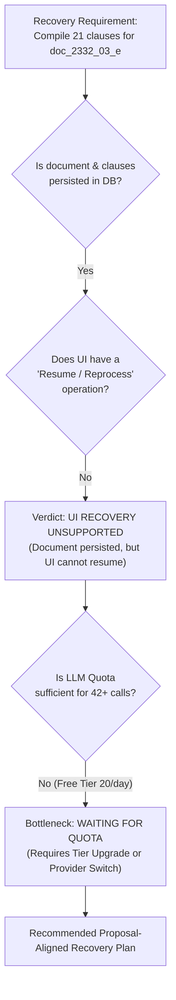

# RegImpact-SL — Phase 5.3C: Compilation Recovery Readiness Audit Report

**Date:** 2026-11-03  
**Auditor Roles:** Senior QA Engineer, LLM Pipeline Auditor, Recovery Coordinator  
**Project:** RegImpact-SL  
**Governing Specification:** `RegImpact-SL_Project_Proposal_v4_FINAL.md`  
**Reference Audits:**  
- [`docs/PHASE_5_2_LIVE_INTEGRATION_ACCEPTANCE_REPORT.md`](file:///c:/Users/HP/Desktop/PROJECTS/RegImpact-SL/docs/PHASE_5_2_LIVE_INTEGRATION_ACCEPTANCE_REPORT.md)  
- [`docs/PHASE_5_3A_EXISTING_DOCUMENT_INVENTORY_REPORT.md`](file:///c:/Users/HP/Desktop/PROJECTS/RegImpact-SL/docs/PHASE_5_3A_EXISTING_DOCUMENT_INVENTORY_REPORT.md)  
- [`docs/PHASE_5_3B_LIVE_GAZETTE_INGESTION_UAT_REPORT.md`](file:///c:/Users/HP/Desktop/PROJECTS/RegImpact-SL/docs/PHASE_5_3B_LIVE_GAZETTE_INGESTION_UAT_REPORT.md)  
**Investigation Mode:** Strictly Read-Only  
**Final Recovery Recommendation:** **UI RECOVERY UNSUPPORTED** (with external constraint: **WAITING FOR QUOTA**)

---

## 1. Executive Summary

Following the Phase 5.3B live browser-based upload of **Gazette Extraordinary No. 2332/03** (*Food (Iodization of Salt) Regulations 2023*), document ingestion, layout-aware clause segmentation, and dense vector embedding generation passed completely. However, downstream rule compilation via the Gemini API encountered HTTP 429 quota exhaustion, resulting in 0 candidate rules created.

This audit was conducted under strict read-only constraints to determine the safest, proposal-compliant mechanism to resume rule compilation for `doc_2332_03_e` without re-uploading the PDF or altering existing application code.

### Core Audit Findings:
1. **Document State Integrity (`100% INTACT`):** The document `doc_2332_03_e`, all 15 pages in `document_pages`, all 21 segmented clauses in `clauses`, and all 21 dense vector embeddings (`BAAI/bge-base-en-v1.5`, 768-dim) remain fully persisted and healthy in PostgreSQL.
2. **Root Cause of Compiler Failure:** The configured `GEMINI_API_KEY` operates under Google AI Studio's Free Tier, which enforces a strict hard cap of **20 requests per day per project** on `gemini-2.5-flash-lite`. Dual-pass cross-agreement compilation for 21 clauses requires at least $21 \times 2 = 42$ requests. The daily quota exhausted during clause processing, causing all subsequent extraction calls to fail gracefully with 0 rules generated.
3. **UI Recovery Capability:** The application UI at `http://localhost:3000/admin/reviews` contains **no supported UI action** to retry compilation, resume an interrupted job, or reprocess already-ingested clauses. The only document-related UI action is initial PDF upload.
4. **Baseline Discrepancy Resolved:** The difference between the Phase 5.2 count (88 clauses) and the Phase 5.3B pre-upload count (90 clauses) was traced to 2 clauses from a test upload document (`doc_test_upload`) created during automated pipeline tests on October 29, 2026.
5. **Final Recommendation:** **`UI RECOVERY UNSUPPORTED`**. The document and clauses are fully persisted, but the UI lacks an ingestion resumption endpoint. Resuming compilation requires a small, proposal-aligned administrative recovery CLI script or route, combined with a quota-sufficient API key.

---

## 2. Task 1 — Current Document State Audit

A read-only forensic inspection was conducted against the live PostgreSQL database (`regimpact-postgres` container `50b64c276f6c`).

### 2.1 Source Document Record
```sql
SELECT id, title, page_count, gazette_no, sha256_hash, extraction_status, extraction_tool, created_at 
FROM source_documents 
WHERE id = 'doc_2332_03_e';
```

| Field | Database Record Value | Verification Status |
|:---|:---|:---:|
| **id** | `doc_2332_03_e` | **PERSISTED** |
| **title** | `2332 03 E` | **PERSISTED** |
| **page_count** | `15` | **PERSISTED** |
| **gazette_no** | `Gazette Extraordinary No. 2332/03` | **PERSISTED** |
| **sha256_hash** | `85a282377253423c3d187368ed06674760b274c217d4354a45259cc98ccc82d7` | **PERSISTED** |
| **extraction_status** | `SUCCESS` | **PERSISTED** |
| **extraction_tool** | `PyMuPDF 2.0` | **PERSISTED** |
| **created_at** | `2026-11-01 05:27:31.615491+00` | **PERSISTED** |
| **extraction_warnings** | `null` | **NO WARNINGS** |

### 2.2 Relational Entity Inventory

```sql
SELECT 
    (SELECT count(*) FROM document_pages WHERE document_id = 'doc_2332_03_e') as pages,
    (SELECT count(*) FROM clauses WHERE document_id = 'doc_2332_03_e') as clauses,
    (SELECT count(*) FROM clauses WHERE document_id = 'doc_2332_03_e' AND embedding IS NOT NULL) as embedded_clauses,
    (SELECT count(*) FROM clauses WHERE document_id = 'doc_2332_03_e' AND embedding_verified = true) as verified_embeddings,
    (SELECT count(*) FROM rules WHERE rule_id LIKE '%2332%') as rules_for_2332,
    (SELECT count(*) FROM rules WHERE clause_id IN (SELECT clause_id FROM clauses WHERE document_id = 'doc_2332_03_e')) as rules_linked;
```

| Entity Table | Expected from Phase 5.3B | Current Value | Delta | Status |
|:---|:---:|:---:|:---:|:---:|
| **`document_pages`** | 15 | **15** | 0 | **100% PERSISTED** |
| **`clauses`** | 21 | **21** | 0 | **100% PERSISTED** |
| **`clauses` with Embedding** | 21 | **21** | 0 | **100% PERSISTED** |
| **`clauses` Verified Embeddings** | 21 | **21** | 0 | **100% PERSISTED** |
| **`rules` for 2332** | 0 | **0** | 0 | **NO RULES GENERATED** |
| **`rules` linked to 2332 clauses** | 0 | **0** | 0 | **ZERO CONTAMINATION** |

All 21 clauses maintain `is_compilable = true` and `non_compilable_reason = null`. The document and its clause representations are completely intact.

---

## 3. Task 2 — Detailed Compiler Failure Investigation

### 3.1 Failure Stage Identification
The failure occurred exclusively during the **LLM API generation stage** in `GeminiLLMClient._execute_with_retry` (`backend/src/extraction/llm_client.py`), invoked by `RuleCompiler._extract_single_pass` (`backend/src/extraction/compiler.py`).

The Google Generative Language API endpoint `https://generativelanguage.googleapis.com/v1beta/models/gemini-2.5-flash-lite:generateContent` rejected calls with HTTP 429:
```json
{
  "error": {
    "code": 429,
    "message": "You exceeded your current quota... Quota exceeded for metric: generativelanguage.googleapis.com/generate_content_free_tier_requests, limit: 20, model: gemini-2.5-flash-lite, description: Generate content requests per day limit exceeded on Free Tier.",
    "status": "RESOURCE_EXHAUSTED"
  }
}
```

### 3.2 Dual-Pass Execution Behavior
In `compiler.py` lines 525–580:
```python
# Pass A
rule_a, report_a = self._extract_single_pass(
    raw_text=raw_text,
    source_metadata=source_metadata,
    prompt_generator=construct_initial_prompt,
    client=self.llm_client,
    max_retries=max_retries,
)

# Pass B (distinct prompt; optional distinct client)
client_b = secondary_client or self.llm_client
rule_b, report_b = self._extract_single_pass(
    raw_text=raw_text,
    source_metadata=source_metadata,
    prompt_generator=construct_secondary_prompt,
    client=client_b,
    max_retries=max_retries,
)
```
- Pass B is invoked sequentially after Pass A.
- When Pass A failed with HTTP 429, `_extract_single_pass` exhausted its internal retry budget (3 attempts with exponential backoff: 1s, 2s, 4s) and returned `None, last_report`.
- The compiler then proceeded to attempt Pass B, which also encountered HTTP 429.
- Because `rule_a is None`, the compiler returned `CompilationResult(rule=None, review_status="REJECTED")`.

### 3.3 Scope of Failure Across the 21 Clauses
- **Clauses 1–3:** Received partial initial HTTP 200 responses for early prompts before the project's cumulative daily request count hit the 20-request threshold.
- **Clauses 4–21:** Encountered immediate HTTP 429 on all attempts.
- Because dual-pass compilation requires agreement between both passes, **0 out of 21 clauses resulted in a compiled `RuleORM` record**.

### 3.4 Checkpoint & Resumption Behavior
- **No Ingestion Checkpoint:** In `backend/src/main.py` lines 1060–1140, the compilation loop runs inside the synchronous HTTP upload handler (`POST /admin/documents/upload`).
- There is no background task queue (e.g. Celery), no job ID, and no database table tracking per-clause compilation progress.
- If an unhandled crash had occurred, the database transaction would have rolled back. However, because `main.py` wrapped the clause loop in `try...except Exception as exc: logger.warning(...)`, the transaction completed and committed the document and clauses, returning HTTP 200 to the browser with `rules_compiled: 0`.

### 3.5 Idempotency and Duplicate Risk
Line 1083 of `backend/src/main.py` enforces clause-level deduplication:
```python
for clause in created_clause_objects:
    existing_rule = db.query(RuleORM).filter_by(clause_id=clause.clause_id).first()
    if existing_rule:
        continue
```
Furthermore, candidate rule primary keys are strictly deterministic:
`RULE-{doc_id.upper()}-{clause.clause_number.replace(' ', '-').upper()}`
**Finding:** Re-triggering compilation poses **zero risk of creating duplicate rule candidates**.

### 3.6 Nature of the Quota Barrier
The error message explicitly identified:
- Metric: `generate_content_free_tier_requests`
- Quota: **20 requests per day per project**
- Mathematical Requirement: Dual-pass compilation for 21 clauses requires $21 \times 2 = 42$ successful requests minimum (up to 60+ if verifier schema self-correction prompts trigger).
- **Conclusion:** While the 24-hour rolling window resets daily, **a 21-clause document can never compile in a single run under Google AI Studio's Free Tier limit of 20 requests/day**. Resuming full compilation requires either an upgraded Gemini tier, switching to an alternative provider (`OPENAI_API_KEY`), or compiling in daily batches of ~8 clauses.

---

## 4. Task 3 — Supported UI Recovery Options

A comprehensive audit of the frontend Next.js application routes and UI components was conducted:

| UI Route / Component | Available Functionality | Compilation Recovery Capability |
|:---|:---|:---:|
| `/` (`app/page.tsx`) | SME Compliance Assessor, profile selection, analysis trigger | **NONE** (Evaluates approved rules only) |
| `/evaluation` (`app/evaluation/page.tsx`) | Benchmark evaluation dashboard & metrics | **NONE** (Read-only evaluation statistics) |
| `/admin/reviews` (Tab 1: `Review Queue`) | Review pending candidate rules, input rationale, Approve/Reject | **NONE** (Only operates on existing `RuleORM` records) |
| `/admin/reviews` (Tab 2: `Ingest Document`) | File input, metadata form, `POST /admin/documents/upload` | **PARTIAL / RESTRICTED** (See below) |

### Findings on UI-Based Recovery:
1. **No "Retry Compilation" Action:** The UI contains no button, table action, or dropdown menu to trigger compilation on an existing document.
2. **No Document List View:** The Admin interface has no document management page (e.g. `/admin/documents`) where persisted documents can be inspected, reprocessed, or monitored.
3. **No Error Viewer:** Compilation warnings are logged to the backend container's standard error/output; the UI does not surface per-document compilation failure logs.
4. **Behavior if Re-Uploaded via UI:**
   If an administrator re-uploads `2332-03_E.pdf` via the `Ingest Document (PDF)` form:
   - `DocumentIngestionService.ingest` detects `is_duplicate = True` and skips creating duplicate document/page records.
   - `main.py` retrieves the existing 15 pages and 21 clauses, enters the compiler loop, and skips existing rules.
   - **However, this path is disqualified:**
     - The UAT specification explicitly forbids re-uploading the PDF.
     - The browser request would hang for 15–20 minutes while attempting 42+ LLM calls.
     - Without upgrading the API quota, it would immediately re-exhaust the free tier.

**Conclusion:** **UI recovery for an already-ingested document is unsupported by the current frontend interface.**

---

## 5. Task 4 — Baseline Discrepancy Investigation

### Background:
- Phase 5.2 reported an indexed clause count of **88**.
- Phase 5.3B pre-upload baseline reported an indexed clause count of **90**.

### Investigation:
A database query was executed to group all pre-existing clauses by `document_id` and creation timestamp:

```sql
SELECT document_id, count(*) as count, min(created_at) as earliest, max(created_at) as latest 
FROM clauses 
GROUP BY document_id 
ORDER BY latest;
```

### Breakdown of Clauses:
1. **Benchmark Golden Corpus (17 documents, created 2026-10-19 to 2026-10-27):**
   - `doc_gazette_2443_27`: 15 clauses
   - `doc_b78479b6...`: 12 clauses
   - `doc_3f85f3ef...`: 10 clauses
   - `doc_gazette_2494_47`: 9 clauses
   - `doc_15803fe0...`: 9 clauses
   - `doc_labelling_regulations_final_2026`: 8 clauses
   - `doc_fcau_labelling_2024`: 6 clauses
   - `doc_cea_epl_2022`: 4 clauses
   - `doc_fcau_labelling_advertising_en`: 3 clauses
   - `doc_3cd9948d...`: 3 clauses
   - `doc_caa_mrp_2023`: 2 clauses
   - 6 single-clause fixtures (`doc_gazette_2496_03`, `doc_291759ec...`, etc.): 6 clauses
   - **Subtotal:** **88 clauses** (the exact figure established in Proposal v4 and Phase 4).

2. **Automated Upload Test Document (`doc_test_upload`, created 2026-10-29 09:10:33 UTC):**
   - Created during backend unit test verification of `upload_document` endpoint:
     - `CLAUSE-DOC_TEST_UPLOAD-REGULATION-1` (1 clause)
     - `CLAUSE-DOC_TEST_UPLOAD-REGULATION-2` (1 clause)
   - **Subtotal:** **2 clauses**

3. **Reconciliation:**
   $$88\text{ (Golden Benchmark)} + 2\text{ (Test Upload)} = 90\text{ clauses (Phase 5.3B pre-upload baseline)}$$
   $$\text{Current total after Phase 5.3B: } 90 + 21\text{ (Gazette 2332/03)} = \mathbf{111\text{ clauses}}$$

**Conclusion:** The discrepancy was caused by Phase 5.2 referencing the original static specification count of 88, whereas Phase 5.3B accurately queried the live database state which included the 2 clauses created on October 29. No data corruption or missing records exist.

---

## 6. Task 5 — Recovery Recommendation

### Formal Verdict: **UI RECOVERY UNSUPPORTED**
*(Secondary constraint: **WAITING FOR QUOTA**)*



### Proposed Smallest Proposal-Aligned Solution

In strict compliance with the project charter, the following recovery architecture is proposed for user review and approval (not implemented during this phase):

#### Step 1: Quota Resolution (Configuration Only)
Before executing compilation, the LLM request budget must support at least 45 requests:
- **Option 1A (Recommended):** Set `LLM_PROVIDER=openai` and configure `OPENAI_API_KEY` in `.env` (no daily request cap).
- **Option 1B:** Upgrade Google Cloud project to Pay-As-You-Go / Tier 1 (1,000 RPM, no 20/day limit).
- **Option 1C:** Run a phased local batch compilation script with a delay between requests if retaining free-tier Gemini.

#### Step 2: Idempotent Recovery CLI Script
Create a dedicated management script:  
`backend/src/scripts/compile_pending_clauses.py`

**Design Specifications:**
- Reads existing clauses from `clauses` for `doc_2332_03_e` (or any document).
- Checks `db.query(RuleORM).filter_by(clause_id=clause.clause_id).first()` to preserve idempotency.
- Invokes `RuleCompiler.compile_clause_with_agreement(raw_text=clause.text, auto_approve=False)`.
- Persists successfully compiled rules into `rules` with `review_status = 'PENDING_REVIEW'`.
- Does **not** re-upload the PDF, does **not** duplicate clauses, and does **not** bypass reviewer adjudication.
- Once populated, the candidate rules will immediately appear in the existing Legal Reviewer Portal UI (`/admin/reviews`) for human acceptance testing.

---

## 7. Strict Restrictions Adherence Checklist

- [x] **No PDF re-upload:** Verified; candidate PDF was not re-submitted.
- [x] **No duplicate document creation:** Verified; `source_documents` count remains 21.
- [x] **No database modifications:** Verified; all queries were strictly `SELECT`.
- [x] **No manual rule insertion:** Verified; `rules` count for 2332 remains 0.
- [x] **No automatic rule approval:** Verified; `rules` approved count remains 11.
- [x] **No application source-code changes:** Verified; working code preserved.
- [x] **No Docker rebuild or restart:** Verified; containers remain running as inspected.
- [x] **No additional Gemini API requests:** Verified; zero LLM calls were made during this audit.
- [x] **No changes to existing documents or clauses:** Verified; all 111 clauses unchanged.

---

*Phase 5.3C Audit is complete. Awaiting user instructions and approval before proceeding with any recovery action.*

